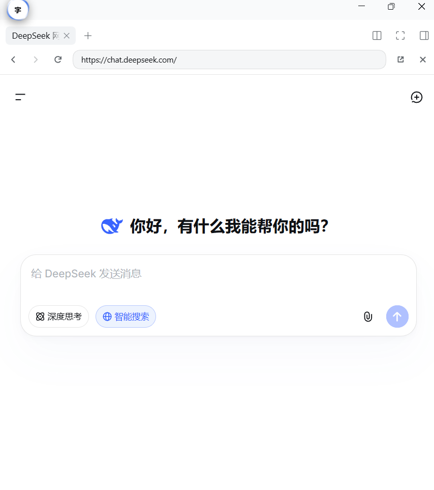
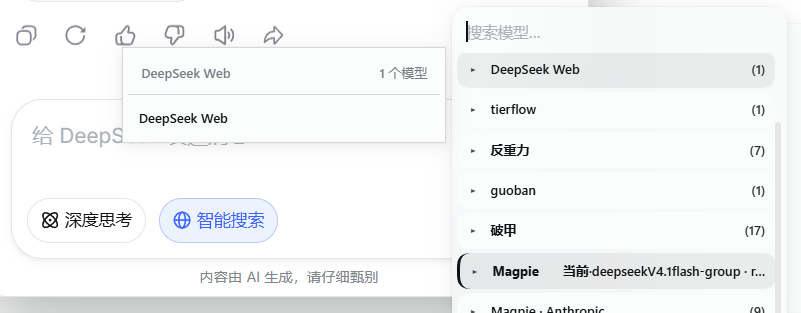
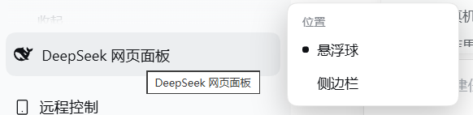
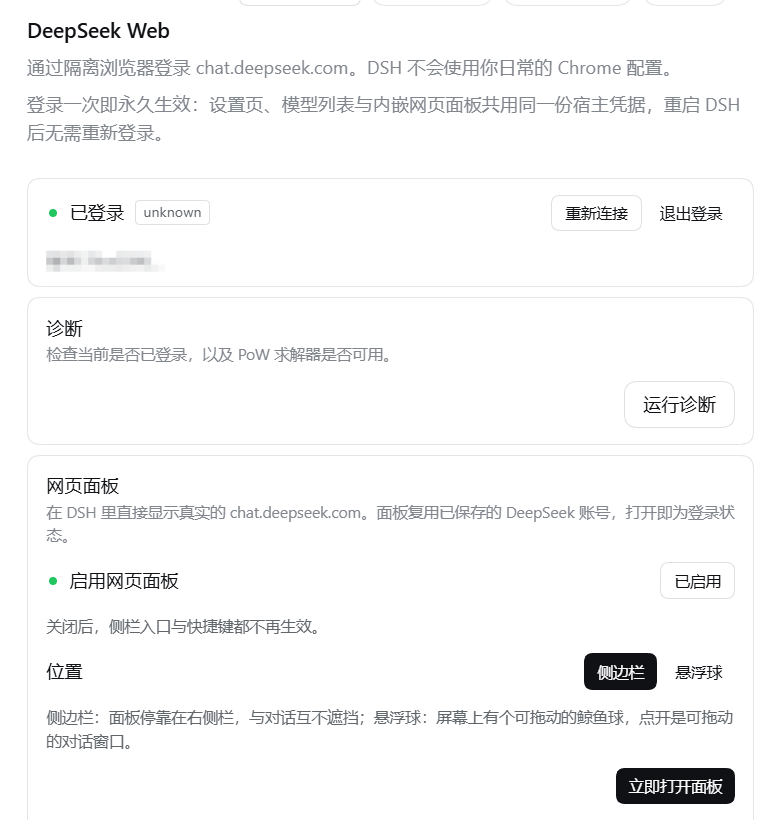

<div align="center">

# dsh-deepseek-web-free

> **功能描述**：把 DeepSeek 网页版桥接进 DSH：不花 API 额度就能跑短上下文对话、工作流与技能包，直接发图片也能免费识图。带悬浮球与侧边栏，一键登录后长期保持登录；正文任意文字右键即可投送到网页端输入框，投送前自动清空原输入框，不用再扫码、跳转、复制粘贴。适配 DSH 内核 0.2.2-rc.1。
>
> **English**: Bridges the DeepSeek web client into DSH, so short-context conversations, workflows and skill packs run without an API key, and a picture pasted in DSH gets read for free. Ships a floating ball plus sidebar, one-click login that stays logged in, and a right-click action that sends any selected text into the web input after clearing it, so no more QR scanning, tab switching or manual pasting. Adapts DSH kernel 0.2.2-rc.1.


**把 DeepSeek 网页端接入 DeepSeek Harness，并在对话界面内嵌网页面板 —— `y-wi/dsh-deepseek-web` 的 fork**

[English](https://github.com/loyalchiiina/dsh-deepseek-web-free/blob/main/docs/README.en.md) · [安装](https://github.com/loyalchiiina/dsh-deepseek-web-free/blob/main/docs/INSTALL.md) · [npm](https://www.npmjs.com/package/dsh-deepseek-web-free) · [CHANGELOG](https://github.com/loyalchiiina/dsh-deepseek-web-free/blob/main/CHANGELOG.md)

[](https://www.npmjs.com/package/dsh-deepseek-web-free)
[](https://github.com/loyalchiiina/dsh-deepseek-web-free/blob/main/LICENSE)
[](https://nodejs.org)

**开源 TypeScript 集成层** · 预编译 WASM 协议核心

<h3>
请严格遵循相关使用政策，禁止将此项目用于反代等破坏系统正常运行的行为，仅限个人学习使用
</h3>

</div>

非官方 Provider。本仓库开放 Harness **集成层与传输层**；协议兼容由随包分发的预编译 WebAssembly 提供。

本项目与 DeepSeek **无隶属或背书关系**。使用你自己的 DeepSeek 账号。插件不会绕过 CAPTCHA、WAF 或账号访问控制；交互式验证在隔离浏览器窗口中完成。

> [!WARNING]
> **免责声明（务必先读）**
>
> 本插件只是为了**让你在 DSH 里直接用 DeepSeek 网页端更方便**：它复用你**自己的** DeepSeek 网页账号登录态来过模型请求，也可以把网页面板嵌进 DSH 侧栏 / 悬浮球里直接对话。它**不加速、不绕过**任何风控，也不承诺长期可用。
>
> **使用网页端能力可能存在账号风险**（包括但不限于：被限流、被临时或永久封禁、会话异常、页面行为变化导致功能失效）。**由此产生的任何后果由使用者自行承担，本项目与作者不承担任何责任**，也不提供任何形式的担保。请自行评估风险后再决定是否登录使用。
>
> 本项目与 DeepSeek 无隶属或背书关系，请遵守 DeepSeek 的服务条款与使用政策。

## 关于本 fork

本包是 [`y-wi/dsh-deepseek-web`](https://github.com/y-wi/dsh-deepseek-web) 的 fork。上游包名 `dsh-deepseek-web` 已被原作者占用，无法同名发布，故本 fork 的 npm 包名改为 **`dsh-deepseek-web-free`**。

**装包请认准名字 `dsh-deepseek-web-free`。** 装成 `dsh-deepseek-web` 拿到的就是上游原版，不含下面这些修复。

相对上游（基线 1.0.3）的改动，逐条见 [CHANGELOG.md](https://github.com/loyalchiiina/dsh-deepseek-web-free/blob/main/CHANGELOG.md)：

| 改动 | 说明 |
| --- | --- |
| 适配 DSH 0.2.1-alpha.2 | `@deepseek-ai/dsh-settings` 移除了 `installSettingsSection` / `settingsNamespace` 导出（ESM 具名导入缺名 = 链接期 SyntaxError）→ 改用 `ctx.settings.configure()`，配置字段标 `.volatile()` |
| 客户端图标换名 | `Icon*Outline14/16` 已废除 → `Icon*OutlineRegular` / `*OutlineMedium`（否则 React error #130，槽位渲染崩） |
| `peerDependencies` 改范围写法 | 精确钉版会被 DSH 插件兼容性门禁**静默拒绝装载**且零日志 |
| 不再吞掉上游错误 | 服务端 SSE `hint` 带 `type:"error"`（如 `finish_reason:"backend_err"`）时，原来返回**空消息并当作成功**，毒化历史、下一轮报 `invalid message id`；现在直接抛出可见错误 |
| 修会话列表空 | 改名后遗留 `pathname.slice(34)` 硬编码 —— 34 是旧前缀长度，新前缀长 39，切出 `"sions"` 导致所有 sessions 请求 404 |

**保持不变的部分（有意为之，勿改）**：`provider` id 仍是 `deepseek-web`；浏览器 profile 目录仍用旧名 `browser-profiles/dsh-deepseek-web`、缓存目录仍用 `cache/dsh-deepseek-web/browser` —— 改名会导致已登录用户丢失登录态。

## 安装

需要 DeepSeek Harness **0.1.0-rc.7**（或兼容版本），Node `^22.19.0 || >=24.0.0`。

```bash
dsh plugin --profile web add dsh-deepseek-web-free
dsh plugin --profile web peers check
dsh web
```

然后到 **设置 → DeepSeek Web → Sign in with DeepSeek**。确认 Provider `deepseek-web` 出现，模型 `default` 可见（1.0.31 起不再提供独立的 Expert 模型；历史配置里的 `expert` 会自动归一到 `default`）。

DSH / Cordis / React 由运行时 `$DSH_HOME/profiles/node_modules` 提供，不会在插件目录再装一份。

<details>
<summary>TUI、CLI 与更新</summary>

TUI 侧由 `./tui` 导出提供（`lib/tui.js`，注册 `deepSeekWebTui` 服务与 `deepseek-web` 命令树）：

```bash
dsh plugin --profile dsh-tui add dsh-deepseek-web-free
dsh-tui
```

本包带 CLI 可执行入口 `dsh-deepseek-web-free` → `lib/bin.js`（`package.json` 的 `bin` 字段）：

```bash
dsh plugin --profile web exec dsh-deepseek-web-free status
dsh plugin --profile web exec dsh-deepseek-web-free login
dsh plugin --profile web exec dsh-deepseek-web-free doctor
```

升级：

```bash
dsh plugin --profile web update dsh-deepseek-web-free
```

**无界面回退**（`login --token-stdin`）：从 stdin 读一行 token，调上游 `currentUser()` 校验，只打印脱敏后的账号哈希前缀与「把 token 存进 DSH 凭证的哪个键名」，**不落盘、不写凭证**。它**不能替代浏览器登录**：

```bash
dsh plugin --profile web exec dsh-deepseek-web-free login --token-stdin
```

> 直接执行 `lib/bin.js`（不经 `dsh`）时，`status` / `doctor` / `login` / `logout` / `browser` 只会打印提示，让你改用 `dsh plugin ... exec` —— 因为凭证解析和浏览器 profile 都要靠 DSH 运行时。无参数则打印 usage。

</details>

<details>
<summary>包导出（供其他插件/宿主引用）</summary>

`package.json` 的 `exports` 共六项：

| 子路径 | 目标 | 用途 |
| --- | --- | --- |
| `.` | `lib/index.js` | 插件主体（宿主侧） |
| `./client` | `lib/client.js` | 客户端 `__ModuleLoader__.load` bundle |
| `./tui` | `lib/tui.js` | TUI profile 侧 |
| `./invariant` | `lib/invariant.js` | 向 `ctx.invariants` 注册包名不变量 |
| `./cordis.patch.yml` | `cordis.patch.yml` | 装载补丁 |
| `./package.json` | `package.json` | 元数据 |

</details>

## 能力

（截图资源只在 GitHub 仓库中提供，npm 包内不含。）

**网页面板（1.0.12 起）：** 除了「把网页端当模型」，插件还能把 `chat.deepseek.com` **直接嵌进 DSH 界面**——右侧栏标签页，或一颗可拖动、可拉伸的**鲸鱼悬浮球窗口**（位置与尺寸跨重启记忆、拖球时窗口跟随）。**登录只需一次**：设置页登录与面板内登录双向同步，退出也一样同步，重启后无需重登。详见下文「网页面板」一节。

<table>
<tr>
<td>

<p><b>网页面板（侧边栏）。</b> 在 DSH 右侧栏直接打开真实的 <code>chat.deepseek.com</code>，与对话左右并列、互不遮挡；也可切换成悬浮球。</p>
</td>
</tr>
<tr>
<td>

<p><b>面板内对话 + 换模型。</b> 在面板里直接与 DeepSeek 对话，还能搜索并切换模型 / 分组。底部保留网页端原生的「深度思考」「智能搜索」开关。</p>
</td>
</tr>
<tr>
<td>

<p><b>位置切换。</b> 悬浮球（可拖动、可拉伸的鲸鱼窗口）/ 侧边栏，一键切换。</p>
</td>
</tr>
<tr>
<td>

<p><b>设置页。</b> 隔离浏览器登录（一次登录长期有效）、诊断、启用网页面板、选择位置、立即打开。</p>
</td>
</tr>
</table>

| 能力 | 说明 |
| --- | --- |
| DSH 原生工具 | 将 DeepSeek 网页端接入 Harness；插件把模型输出转成工具请求。FS / Shell / MCP / 审批由 Harness 执行 |
| 网页搜索 | 始终开启官方网页端 Web Search；不是 DSH `web_search` |
| 预构建 WASM | 安装无需 Rust / wasm-pack；token 与 cookie **不进入** WASM |
| 网页面板 | 在 DSH 界面内以侧边栏 tab 或鲸鱼悬浮球直接打开 `chat.deepseek.com`；登录态由 Host 侧凭据自动注入，免二次登录 |
| 图片输入 | 直接在 DSH 发图，插件读取图片经网页端 `upload_file` 上传、`fetch_files` 轮询就绪，随消息以 `ref_file_ids` 发送，由 DeepSeek 完成识图并回传；支持 PNG / JPEG / WebP / GIF，单张上限 5 MB |
| 选中文字右键 | 会话里选中文字后右键，菜单多出「复制」与「复制到 DeepSeek 网页」；按位置偏好自动打开悬浮球或侧边栏，先清空 DeepSeek 输入框再写入，并自动关掉风险提示弹窗 |

详见 [docs/remote-sessions.md](https://github.com/loyalchiiina/dsh-deepseek-web-free/blob/main/docs/remote-sessions.md)。

## 网页面板（侧边栏 / 悬浮球）

面板有两种形态，在 设置 → DeepSeek Web → 网页面板 → 位置 里切换：

| 形态 | 表现 | 关闭方式 |
| --- | --- | --- |
| 侧边栏（默认） | 在右侧栏里开一个独立的 DeepSeek 网页 tab，与内置「浏览器」tab 并列，对话与网页左右并列互不遮挡 | 点 tab 上的 ✕，或关掉该 tab |
| 悬浮球 | 屏幕上常驻一颗可拖动的鲸鱼圆球，点开是默认 420×640 的小窗口，右缘/下缘/右下角可拉伸调宽高（最小 320×420），尺寸自动记忆 | 点窗口 ✕、再点一次鲸鱼球，或按 Esc |

- 打开：`Ctrl/Cmd+Shift+D`、侧栏底部「网页面板」开关按钮（按「位置」分派；悬浮球位置下再点一次即收起），或设置页「立即打开面板」。
- 免登录：面板加载真实 `chat.deepseek.com`，Host 侧把已保存的凭据通过 `GET /plugins/dsh-deepseek-web/webpanel/token` 注入到页面存储，因此每次都是已登录状态。
- 平台：两种形态都需要 DSH 桌面端（Electron webview）；浏览器版 DSH 只显示提示。


除了把 DeepSeek 网页当模型用，插件还能在 DSH 界面里**直接打开 DeepSeek 网页本身**：屏幕边上挂一颗鲸鱼悬浮球，点开就是真实的 `chat.deepseek.com` 页面，可以直接在 DSH 里和网页端对话。

### 打开方式

- `Ctrl+Shift+D`（macOS 为 `Cmd+Shift+D`）打开（侧边栏位置下开 tab，悬浮球位置下展开窗口）
- 设置 → DeepSeek Web → 「网页面板」→ 立即打开
- 侧栏底部「网页面板」开关按钮（1.0.14 起替代原「DeepSeek Web 会话」弹层入口）
- 侧栏会话列表每一行右侧的小按钮「在面板打开」→ 直接跳到该网页会话（深链 `chat.deepseek.com/a/chat/s/<id>`）

### 交互

| 操作 | 行为 |
| --- | --- |
| 拖鲸鱼球 | 球可自由拖动，位置记忆；移动不超过 4px 视为点击 |
| 拖窗口标题栏 | 窗口可自由拖动，位置记忆；超出屏幕自动收回可视区 |
| `Esc` | 关闭窗口（球保留） |
| 标题栏 ← / → | 后退 / 前进 |
| 标题栏刷新 | 刷新（加载中变「停止」） |
| 标题栏「在系统浏览器打开」 | 交给系统默认浏览器 |
| 关闭窗口 | 只隐藏不卸载（`visibility:hidden`，不用 `display:none`，否则 Electron 停合成 → 再开黑屏），网页状态与草稿保留；切换位置或关闭面板时才释放 guest |
| 鲸鱼图标 | 官方 DeepSeek 标志，`currentColor` 上色：浅色主题黑、深色主题白 |

### 选中文字右键菜单（1.0.34 起，纯客户端）

在会话消息里选中文字后右键，弹出的不再是宿主原生那条只有「复制」的系统菜单，而是插件渲染的同款浅色菜单（Windows 11 风格，8px 圆角 / 32px 行高），两项：

- **复制**：写入系统剪贴板，提示「已复制」。
- **复制到 DeepSeek 网页**：按 设置 → DeepSeek Web → 网页面板 → 位置 打开对应界面，等页面就绪后把选中文字**清空式写入** DeepSeek 输入框（不追加）。

▶ **[观看效果视频：选中文字 → 右键 → 复制到 DeepSeek 网页（MP4）](https://github.com/loyalchiiina/dsh-deepseek-web-free/releases/download/v1.0.35/right-click-copy-to-deepseek.mp4)**

细节：位置=悬浮球 → 自动展开悬浮球窗口（窗口收起/隐藏但 webview 仍挂载也会展开）；位置=侧边栏 → 打开/切到侧边栏 DeepSeek 标签页（已在则不重复开）；打开前先让另一面退出并留 200ms 释放共享会话；会顺手点掉 DeepSeek 风险提示弹窗（加载后立即点一次，再以 150ms 节奏观察 8 秒）；结果提示：成功「已复制到 DeepSeek 网页输入框」，22 秒内没等到页面就绪「打开 DeepSeek 网页超时，请先手动打开面板再试」，写入失败自动回退剪贴板并提示 Ctrl+V。只在**有选中文字**时接管右键，未选中时右键行为不变。

### 只有一个 webview 活着（切换与重挂）

侧边栏标签页与悬浮球共用同一 DeepSeek 存储分区，两个 guest 同时挂载会让后起的那个白屏/卡死，也会让侧边栏发送按钮失灵。因此：

- **先退后开**：切到悬浮球先关侧边栏 DeepSeek 标签页（释放共享会话）再开球；切到侧边栏先卸载悬浮球 guest 再开 tab；复制到网页前的自动打开同样先关另一面并留 200ms。
- **隐藏 ≠ 卸载**：点 ✕ / Esc / 再点一次鲸鱼球只是 `visibility:hidden`（保留绘制、网页状态与草稿），不用 `display:none`（Electron 会停止合成 `<webview>`，再开即黑屏/卡死）。
- **重挂重建**：窗口被完全卸载（切换位置、关闭面板）后再开，旧 `<webview>` 已脱离 DOM；插件检测到元素不在文档上会先释放 guest 再新建 webview，而不是对旧元素 navigate。
- **发送修复**：写入输入框用 React 原生 value setter + `input` 事件（不派发 `change`），保证发送按钮状态同步；切换位置时释放旧 guest，避免两个 guest 抢同一会话导致侧栏 WebSocket/发送异常。

### 免登录是怎么做的

插件把已保存的 DeepSeek 账号 token 通过同源路由 `GET /plugins/dsh-deepseek-web/webpanel/token` 交给渲染进程，面板在自己的 guest 分区里把 token 写进 `localStorage.userToken` 然后刷新页面——网页自己完成登录，PoW、WebSocket、API 全部在页面内原生跑，**不需要在面板里再登录一次，也不走任何本地反代**。

> token 只在 Host 与 DSH 渲染进程之间传递，不落盘、不出现在页面 URL 里；路由受 `trustedPluginRequest` 保护（仅 loopback + 同源）。

### 登录统一（反向同步，1.0.20 起）

面板的 guest 分区是内存分区（每次启动换新的 `partition`），所以在面板里手动登录得到的会话**关窗即失效**。1.0.20 补上了反向通道，两个入口共用同一份宿主凭据：

- **面板里登录 → 自动永久**：页面登录后，插件读取页面自己的 `localStorage.userToken`，POST 到同源路由 `/plugins/dsh-deepseek-web/auth/import`；Host 先用上游 `currentUser()` 校验，通过才写入 DSH 凭据库。下次重启直接免登录。
- **设置页里登录 → 面板自动生效**：宿主凭据仍是唯一真源，面板加载时照旧注入（见上节）。
- **未登录提示条**：面板顶部检测到宿主未登录时显示说明 +「一键登录」，走宿主登录流程（弹出隔离浏览器），成功后自动刷新面板。
- 设置页与 README 都写明「登录一次即永久生效」，避免新用户以为面板是另一个账号体系。

### 平台限制

面板依赖 DSH 桌面端的 Electron `<webview>` 通道（`window.dshDesktop.browser`）。Web 端因为没有该通道，面板会提示「仅桌面端可用」——`chat.deepseek.com` 的 CSP `frame-ancestors 'none'` 不允许普通 iframe 嵌入。

### 与既有能力共存

原有功能全部保留、互不影响：provider `deepseek-web` 的模型列表（`default`）、DeepThink 思考开关、网页搜索、侧栏会话接续、派生到工作区、隔离浏览器登录与 profile。

## 模型

| ID | 名称 | 输入模态 | 网页原生搜索 |
| --- | --- | --- | --- |
| `deepseek-web/default` | DeepSeek Web | 文本 + 图片 | 每轮开启 |

思考为 `on` / `off`（默认 `on`）。`default` 的每一轮（含续写和 `/clean`）都会打开网页搜索，插件设置里关不掉。引用来源会出现在时间线上；不会注册 DSH `web_search` 提供方。

**支持图片输入**：在 DSH 里直接发图，插件会把图片读取为附件并经网页端上传（`upload_file` + `fetch_files` 轮询），随消息以 `ref_file_ids` 一起发送，由 DeepSeek 网页端完成识图后把结果回传。支持 PNG / JPEG / WebP / GIF，单张上限 5 MB。

## 装载行为与可配置项

### ⚠️ 装载补丁会改默认模型

`cordis.patch.yml` 不只有「插入插件」，它还有一条**覆盖宿主默认模型**的补丁：

```yaml
- id: agent-default-model
  config:
    provider: deepseek-web
    model: default
```

也就是说：**装上本插件后，新会话的默认模型会变成 `deepseek-web/default`。** 如果你此前在设置里**显式保存过**默认模型，那份保存值会胜过这里的 bundle 默认值（补丁注释里写明 "A saved agent-default-model setting, when present, still wins over this bundle value"）；如果你从没手动设过，就会落到 `deepseek-web/default`。不想改默认模型的话，装完到设置里重新选一次即可。

> 这条是**上游行为，本 fork 原样承袭**（上游 `packages/plugin/cordis.patch.yml` 同样有这一块）。注意：某些本地安装的上游副本（如 `profiles/web/node_modules/dsh-deepseek-web`）被人为改过，注释写着 "Locally adjusted by DSH … upstream agent-default-model override stripped"，把这段删了 —— 那是本地改的，不是上游发布态。**判断"插件装完会不会改默认模型"，要看你实际安装的那份 `cordis.patch.yml`，别照着别处的副本推断。**

### patch 同时插入 provider 与 TUI 两个条目

上游的 `cordis.patch.yml` 除了 provider，还会顺带插入一条 TUI 条目。本 fork 与上游结构一致：

```yaml
- insert:
    - id: llm-deepseek-web-free
      name: dsh-deepseek-web-free
    - id: deepseek-web-free-tui
      name: dsh-deepseek-web-free/tui
      inject: [deepSeekWeb]
```

第二条让 `lib/tui.js`（注册 `deepSeekWebTui` 服务、提供 `/deepseek-web` 命令与 TUI 命令树）在 TUI profile 里**自动挂载**。

> **历史（v1.0.9 及更早）**：1.0.6 改包名时只改出第一条 insert，第二条被漏掉——`exports["./tui"]` 与 `lib/tui.js` 都在，但**永远不会被挂载**（`deepSeekWeb` 服务在 TUI 里不存在）。v1.0.10 补回。这个 bug 的特征是「文件在、导出在、插件启动正常，只是那个子能力静默消失」，任何"文件存在性"检查都会放行。

### 用户可配置字段

`Config` schema（`lib/index.js`，Schemastery `z.object`，全部字段标 `.volatile()`）暴露这些：

| 字段 | 类型 / 取值 | 默认 | 说明 |
| --- | --- | --- | --- |
| `tokenEnv` | 字符串（`.role("credential-ref")`） | `DEEPSEEK_WEB_TOKEN` | 到 DSH 凭证存储里取 token 用的键名 |
| `defaultModel` | `default`（历史配置里的 `expert` 自动归一到 `default`） | `default` | 新建会话用哪个模型 |
| `thinking` | `enabled` \| `disabled` | `enabled` | DeepThink 推理 |
| `streamIdleTimeoutMs` | 数字 | `180000` | SSE 空闲超时（毫秒） |
| `maxToolProtocolBytes` | 数字 | `131072` | 单次工具协议块字节上限 |
| `maxToolCallsPerTurn` | 数字，**须为 1..32 整数** | `16` | 每轮最多工具调用数；越界会抛 `maxToolCallsPerTurn must be an integer in 1..32` |
| `maxProtocolRepairAttempts` | 数字 | `2` | 协议解析失败的修复重试次数 |
| `maxToolResultBytes` | 数字 | `65536` | 单个工具结果回传上限 |
| `browser.preferred` | `auto` \| `chrome` \| `edge` \| `brave` \| `chromium` \| `managed` | `auto` | 登录用哪个浏览器；`managed` 表示由插件托管下载 |
| `browser.allowManagedDownload` | 布尔 | `true` | 允许插件自行下载托管浏览器 |

配置写坏时不会崩：`options()` 会保留上一次的好配置并打一条 `keeping last good configuration after invalid settings`。

> 注：`nativeSearch` 虽然出现在内部默认值里，但**不在** `Config` schema 中 —— `resolveConfig` 里硬编码成 `"on"`，所以用户改不了，这与下面「模型」节的描述一致。

## 命令

斜杠命令不会把 `/…` 原文发给模型。

- `/deepseek-web [status|login|logout|doctor]` — 账号相关
- `/clean [message]` — 当前会话开关。打开后后续每一轮只发送你的原文（不含系统提示、工具、skills）。再执行一次 `/clean` 关闭。

## 数据去向 / 隐私边界

`package.json` 的 `disclosure` 字段是本插件的**机器可读隐私声明**，内容与下面逐条对应：

| 字段 | 取值 | 含义 |
| --- | --- | --- |
| `cloud` | `true` | 会把对话内容发到云端服务 |
| `network` | `https://chat.deepseek.com` | **唯一**外联目标。插件不访问 `api.deepseek.com`，也不访问任何第三方域名 |
| `offlineMode` | `false` | 不支持离线使用 |
| `apiKeys[0].env` | `DEEPSEEK_WEB_TOKEN` | 凭证键名（`tokenEnv` 的默认值） |
| `apiKeys[0].storage` | `dsh-credentials` | 凭证只写进 DSH 凭证存储，不写插件目录明文 |
| `permissions.network` | `chat.deepseek.com` | 网络权限范围 |
| `permissions.filesystem` | `plugin-isolated-browser-profile` | 唯一文件系统访问范围是插件隔离的浏览器 profile |
| `permissions.env` | `DEEPSEEK_WEB_TOKEN` | 读取的环境变量只有这一个 |
| `jurisdiction` | `PIPL(CN)` | 受中华人民共和国个人信息保护法约束 |
| `retention` | `session` | 凭证/会话数据保留到会话期，不做长期归档 |

具体地：

- **发出去的是什么**：你的消息文本、系统提示、工具定义（除非 `/clean` 打开）、以及 Harness 侧的工具结果，经 `chat.deepseek.com/api/v0/` 的 HTTPS/SSE 通道发给 DeepSeek 网页端。响应只回流到本机。
- **不发出去的是什么**：插件**不**上传本地文件、不采集遥测、不内嵌任何分析 SDK。文件要想让模型看到，必须由 Harness 的读文件工具读成文本再进对话。
- **本机留下了什么**：① DSH 凭证存储里的 token（键名 `DEEPSEEK_WEB_TOKEN`）；② 插件隔离浏览器 profile，位于 DSH 主目录下的 `browser-profiles/dsh-deepseek-web`（有意沿用旧名）；③ 浏览器缓存位于 `cache/dsh-deepseek-web/browser`。这三处之外不写盘。
- **谁在执行**：DeepSeek Web 没有官方 function calling。插件只**解析**模型输出并转成工具请求；适配器**从不**执行 shell、读盘或 MCP —— 真正的执行在 Harness 侧，受 Harness 的审批门管控。

## 架构

| 层 | 职责 |
| --- | --- |
| TypeScript 开源层 | HTTP、SSE、浏览器登录、凭证、DSH 适配器、工具桥、回放 |
| 预编译 WASM 核心 | 协议兼容与 PoW |

宿主侧 HTTP 路由挂在 `/plugins/dsh-deepseek-web/` 前缀下（`auth/login`、`auth/logout`、`auth/cancel`、`auth/status`、`doctor`、`account`、`fork`、`sessions`）。这些是插件内部路由，不构成对外 API。

## 安全

- 不要打印 `.credentials.yaml`、Bearer token、CDP 地址或浏览器配置目录的绝对路径（`lib/bin.js` 出错时走 `redactSensitiveText` 后再写 stderr）
- 登录只使用插件隔离 profile
- 凭证只写入 DSH 凭证存储

披露流程见 [SECURITY.md](https://github.com/loyalchiiina/dsh-deepseek-web-free/blob/main/docs/SECURITY.md)。浏览器登录细节见 [docs/browser-auth.md](https://github.com/loyalchiiina/dsh-deepseek-web-free/blob/main/docs/browser-auth.md)。

## 仓库结构

**根目录是 npm 包 `dsh-deepseek-web-free` 的发布根**：`lib/`（构建产物）、`wasm/`（预编译协议核）、`cordis.patch.yml`、`package.json`、`README.md`、`LICENSE`、`CHANGELOG.md`、`docs/`。`files` 白名单锁定的就是这些。

仓库里另有一批**只为开发/存档服务、不进 npm 包**的目录：

| 路径 | 作用 | 进 npm 包 |
| --- | --- | --- |
| `lib/` `wasm/` `cordis.patch.yml` `package.json` `README.md` `LICENSE` `CHANGELOG.md` `docs/` | **插件本体 + 随包文档** | ✅ |
| `packages/` | 上游 `y-wi/dsh-deepseek-web` **1.0.3 的 TypeScript 源码存档**（`compat/` + `plugin/`） | ❌ |
| `docs/upstream/` | 上游原仓库的 README 与工作区 `package.json` 存档 | ❌ |
| `tests/` `scripts/` `tsconfig.base.json` `vitest.config.ts` | 测试、构建脚本、TS/Vitest 配置 | ❌ |
| `pnpm-workspace.yaml` `pnpm-lock.yaml` | 工作区与锁文件 | ❌ |
| `LICENSES/` | 预编译核心的第三方许可原文 | ❌ |
| `.github/` | CI 与模板 | ❌ |

> ⚠️ **`packages/` 里的 TS 源码不能重新构建出当前的 `lib/`。** 1.0.4 起的全部修复是直接改在 `lib/` 构建产物上的（见 CHANGELOG）。**以 `lib/` 为准**，`packages/` 只作 1.0.3 上游基线存档。
>
> 1.0.11 的「网页面板」源码写在 `packages/plugin/src/client/`（`DeepSeekWebPanel.tsx` / `webpanel-guest.ts` / `webpanel-bus.ts` / `webpanel-prefs.ts` 及若干改动文件），但**仍然手工移植进 `lib/client.js`、`lib/index.js` 后发布**，没有走 `pnpm build` 覆盖 —— 原因同上：`pnpm build` 出来的产物缺 1.0.4–1.0.10 的手改修复、且包名不带 `-free`。

> ⚠️ 本机开发副本 `~/.dsh/local-plugins/dsh-deepseek-web` 只保留上表第一行的发布子集，不含 `packages/` `tests/` `scripts/` `LICENSES/` 等开发目录 —— 那是正常的，不是文件丢失。

## 与上游的差异（本插件维护者新增）

本插件基于上游 [y-wi/dsh-deepseek-web](https://github.com/y-wi/dsh-deepseek-web) 1.0.3 基线。相对上游，以下能力由**本插件维护者自行新增/改造**（非上游原有）：

- **内嵌网页面板**：侧栏标签页 + 鲸鱼悬浮球（登录一次，双向同步）——维护者新增。
- **网页搜索（智能搜索）全程开启**：`nativeSearch` 固定为始终开启，主对话每轮都带官方网页搜索，插件内不可关闭；不依赖上游「Expert 才能搜」的旧逻辑。
- **移除 Expert（专家）模式**：原作者的 Expert 分支依赖的网页端行为已变更，不再适用于最新 chat.deepseek.com 与最新 DSH 版本，模型列表不再提供 Expert。
- **图片输入**（1.0.31 起）：发送图片会先上传到 DeepSeek 再随消息发送，模型可识图。
- 持续适配最新网页端与最新 DSH 版本。

上游原有能力：把 DeepSeek 网页端当作 LLM 模型使用（基础文本对话）。
「图片输入」实现思路参考 [agent2api](https://github.com/aimod-cc/agent2api)，本插件为独立实现，未复制其代码。

## 文档

- [安装](https://github.com/loyalchiiina/dsh-deepseek-web-free/blob/main/docs/INSTALL.md)
- [贡献](https://github.com/loyalchiiina/dsh-deepseek-web-free/blob/main/docs/CONTRIBUTING.md)
- [English README](https://github.com/loyalchiiina/dsh-deepseek-web-free/blob/main/docs/README.en.md)
- [上游项目](https://github.com/y-wi/dsh-deepseek-web)
- [参考实现：agent2api](https://github.com/aimod-cc/agent2api)（本版「图片输入」的协议思路来源；本插件为独立实现，未复制其代码）

## 免责声明

- **用途**：本插件仅为方便用户在 DSH 内直接使用 DeepSeek 网页端（当模型、或打开网页面板对话），不提供任何 DeepSeek 官方未开放的加速、绕过或批量能力。
- **账号风险**：把网页端登录态用于第三方客户端**可能违反 DeepSeek 服务条款**，可能导致账号被限流、被冻结或封禁。请使用你自己的账号并自行评估风险。
- **责任**：作者与贡献者**不对任何直接或间接损失承担责任**（包括但不限于账号损失、数据丢失、服务中断）。软件按「现状」提供，不附带任何明示或暗示担保。
- **合规**：请遵守所在地区法律法规与 DeepSeek 的服务条款；若你不同意上述条款，请勿安装或使用本插件。

## 许可证

TypeScript 集成层为 MIT（`LICENSE`，版权声明沿用上游 "dsh-deepseek-web contributors"）。预编译核心的第三方许可原文见上游仓库的 `LICENSES/PROTOCOL_CORE.txt`（该目录不进 npm 包）。第三方声明见上游 `THIRD_PARTY_NOTICES.md`。
