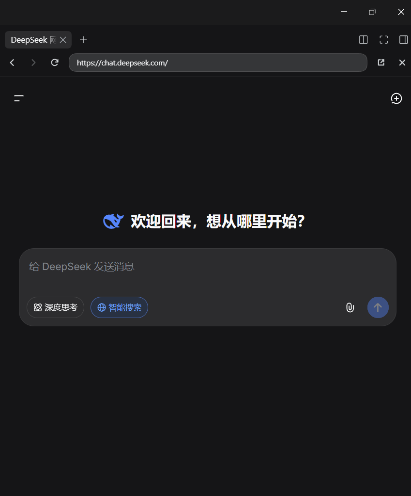
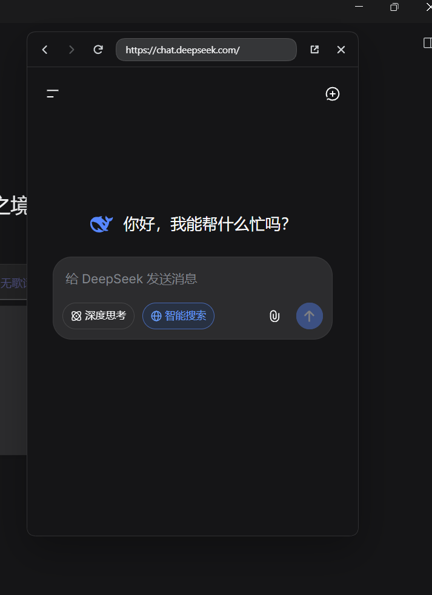
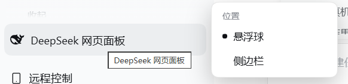
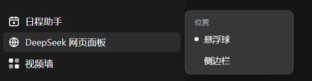

<div align="center">

# dsh-deepseek-web-free

> **功能描述**：仅保留 DSH 内悬浮球与侧边栏打开官方 chat.deepseek.com 网页面板；1.0.44 起已移除 DSH 内直接对话功能。适配 DSH 内核 0.2.2-rc.1。
>
> **English**: Only the floating ball and sidebar that open the official chat.deepseek.com web panel remain; in-DSH chat was removed in 1.0.44. Adapts DSH kernel 0.2.2-rc.1.


**仅保留 DSH 悬浮球与侧边栏打开官方 chat.deepseek.com 网页面板 —— `y-wi/dsh-deepseek-web` 的 fork**

[English](https://github.com/loyalchiiina/dsh-deepseek-web-free/blob/main/docs/README.en.md) · [安装](https://github.com/loyalchiiina/dsh-deepseek-web-free/blob/main/docs/INSTALL.md) · [npm](https://www.npmjs.com/package/dsh-deepseek-web-free) · [CHANGELOG](https://github.com/loyalchiiina/dsh-deepseek-web-free/blob/main/CHANGELOG.md)

[](https://www.npmjs.com/package/dsh-deepseek-web-free)
[](https://github.com/loyalchiiina/dsh-deepseek-web-free/blob/main/LICENSE)
[](https://nodejs.org)

**开源 TypeScript 集成层** · 预编译 WASM 协议核心

<h3>
请严格遵循相关使用政策，禁止将此项目用于反代等破坏系统正常运行的行为，仅限个人学习使用
</h3>
> [!CAUTION]
> **停用公告（2026-11-17，中文）**：2026-11-17 作者实测账号因违反用户使用规范被禁言至 2026-11-20 16:21。1.0.44 起已删除在 DSH 中直接选 DeepSeek Web 模型对话的功能，只保留悬浮球与侧边栏打开官方 chat.deepseek.com 网页面板。请勿再用旧版本复用网页登录态发起对话。本插件不加速也不绕过任何风控，使用后果由使用者自行承担，作者与本项目不承担任何责任。适配 DSH 内核 0.2.2-rc.1。
>
> **Deprecation notice (2026-11-17, English)**: on 2026-11-17 the author observed a real account ban for violating the usage policy, muted until 2026-11-20 16:21. Starting with 1.0.44, selecting DeepSeek Web as a model for in-DSH chat has been removed; only the floating ball and sidebar that open the official chat.deepseek.com web panel remain. Do not use older versions to reuse a web login session to start chats. This plugin neither accelerates nor bypasses any risk control; use is at your own risk, and the author and this project accept no responsibility. Adapts DSH kernel 0.2.2-rc.1.


</div>

非官方网页面板插件。本仓库只保留 DSH 客户端面板集成层；1.0.44 起已移除 DSH 内直接对话与模型提供方能力。

本项目与 DeepSeek **无隶属或背书关系**。使用你自己的 DeepSeek 账号。插件不会绕过 CAPTCHA、WAF 或账号访问控制；日常登录直接在 DSH 网页面板内的官方 chat.deepseek.com 页面完成，交互式验证也由该页面承接（隔离浏览器登录仅作为 CLI / TUI 与 `/auth/login` 调用的备用通道保留）。

> [!WARNING]
> **免责声明（务必先读）**
>
> 本插件**只用于在 DSH 侧栏 / 悬浮球里打开官方 DeepSeek 网页面板**：面板加载时会写入一个 localStorage 标记（`closeUnsafeEnvWarn`）关闭网页端「使用环境异常」这条前端提示，仅隐藏提示文案，不改变也不绕过账号校验、人机验证或风控判定。1.0.44 起已不再提供「把网页端当模型」「在 DSH 内直接对话」「图片识图」等能力；右键投送（选中文字复制到 DeepSeek 网页输入框）仍保留。
>
> **账号风险已发生真实禁言案例**：2026-11-17 作者实测账号因违反用户使用规范被禁言至 2026-11-20 16:21。使用网页端登录态于第三方客户端可能违反 DeepSeek 服务条款，可能导致限流、冻结或封禁。**由此产生的任何后果由使用者自行承担，本项目与作者不承担任何责任**，也不提供任何形式的担保。请勿再用旧版本复用网页登录态发起对话；请自行评估风险后再决定是否使用网页面板。
>
> 本项目与 DeepSeek 无隶属或背书关系，请遵守 DeepSeek 的服务条款与使用政策。

## 关于本 fork

本包是 [`y-wi/dsh-deepseek-web`](https://github.com/y-wi/dsh-deepseek-web) 的 fork。上游包名 `dsh-deepseek-web` 已被原作者占用，无法同名发布，故本 fork 的 npm 包名改为 **`dsh-deepseek-web-free`**。

**装包请认准名字 `dsh-deepseek-web-free`。** 装成 `dsh-deepseek-web` 拿到的就是上游原版，不含下面这些修复。

相对上游（基线 1.0.3）的改动，逐条见 [CHANGELOG.md](https://github.com/loyalchiiina/dsh-deepseek-web-free/blob/main/CHANGELOG.md)：

| 改动 | 说明 |
| --- | --- |
| 适配 DSH 0.2.1-alpha.2 | `@deepseek-ai/dsh-settings` 移除了 `installSettingsSection` / `settingsNamespace` 导出（ESM 具名导入缺名 = 链接期 SyntaxError）→ 改用 `ctx.settings.configure()`，配置字段标 `.volatile()` |
| 客户端图标换名 | `Icon*Outline14/16` 已废除 → `Icon*OutlineRegular` / `*OutlineMedium`（否则 React error #130，槽位渲染崩） |
| `peerDependencies` 改范围写法 | 精确钉版会被 DSH 插件兼容性门禁**静默拒绝装载**且零日志 |
| 不再吞掉上游错误 | 服务端 SSE `hint` 带 `type:"error"`（如 `finish_reason:"backend_err"`）时，原来返回**空消息并当作成功**，毒化历史、下一轮报 `invalid message id`；现在直接抛出可见错误 |
| 修会话列表空 | 改名后遗留 `pathname.slice(34)` 硬编码 —— 34 是旧前缀长度，新前缀长 39，切出 `"sions"` 导致所有 sessions 请求 404 |

**保持不变的部分（有意为之，勿改）**：`provider` id 仍是 `deepseek-web`（仅为历史常量名，1.0.44 不再注册任何 DSH LLM provider/model）；浏览器 profile 目录仍用旧名 `browser-profiles/dsh-deepseek-web`、缓存目录仍用 `cache/dsh-deepseek-web/browser` —— 改名会导致已登录用户丢失登录态。

## 安装

需要 DeepSeek Harness **0.1.0-rc.7**（或兼容版本），Node `^22.19.0 || >=24.0.0`。

```bash
dsh plugin --profile web add dsh-deepseek-web-free
dsh plugin --profile web peers check
dsh web
```

> **桌面端（desktop profile）**：DSH 桌面客户端的 desktop profile 由 Electron 独占管理，`dsh plugin --profile desktop add` 会被 CLI 直接拒绝并提示 `profile "desktop" is managed exclusively by the Electron application`。桌面端请在插件市场安装，或由宿主管理 `~/.dsh/profiles/desktop/package.json` 的 `dependencies` 与 `dsh.profile.bundles` 后再用 pnpm 安装；上面的 `--profile web` 命令只适用于 `dsh web` 实验环境，Web profile 缺 better-sidebar 等宿主插件，装了也不会显示面板。

然后到 **设置 → DeepSeek Web → 打开面板登录**（或直接打开侧边栏 / 悬浮球面板），在面板内官方 chat.deepseek.com 页面完成登录，插件会把 token 自动写回 Host 凭据库。1.0.44 起 DSH 模型列表中不再出现 `deepseek-web` provider 或 `default` 模型；「确认 Provider 出现 / 模型可见」仅适用于旧版本。

DSH / Cordis / React 由运行时 `$DSH_HOME/profiles/node_modules` 提供，不会在插件目录再装一份。

<details>
<summary>TUI、CLI 与更新</summary>

TUI 侧由 `./tui` 导出提供（`lib/tui.js`，注册 `deepSeekWebTui` 服务与 `deepseek-web` 命令树）：

```bash
dsh plugin --profile dsh-tui add dsh-deepseek-web-free
dsh-tui
```

本包带 CLI 可执行入口 `dsh-deepseek-web-free` → `lib/bin.js`（`package.json` 的 `bin` 字段）：

```bash
dsh plugin --profile web exec dsh-deepseek-web-free status
dsh plugin --profile web exec dsh-deepseek-web-free login
dsh plugin --profile web exec dsh-deepseek-web-free doctor
```

升级：

```bash
dsh plugin --profile web update dsh-deepseek-web-free
```

**无界面回退**（`login --token-stdin`）：从 stdin 读一行 token，调上游 `currentUser()` 校验，只打印脱敏后的账号哈希前缀与「把 token 存进 DSH 凭证的哪个键名」，**不落盘、不写凭证**。它**不能替代浏览器登录**：

```bash
dsh plugin --profile web exec dsh-deepseek-web-free login --token-stdin
```

> 直接执行 `lib/bin.js`（不经 `dsh`）时，`status` / `doctor` / `login` / `logout` / `browser` 只会打印提示，让你改用 `dsh plugin ... exec` —— 因为凭证解析和浏览器 profile 都要靠 DSH 运行时。无参数则打印 usage。

</details>

<details>
<summary>包导出（供其他插件/宿主引用）</summary>

`package.json` 的 `exports` 共六项：

| 子路径 | 目标 | 用途 |
| --- | --- | --- |
| `.` | `lib/index.js` | 插件主体（宿主侧） |
| `./client` | `lib/client.js` | 客户端 `__ModuleLoader__.load` bundle |
| `./tui` | `lib/tui.js` | TUI profile 侧 |
| `./invariant` | `lib/invariant.js` | 向 `ctx.invariants` 注册包名不变量 |
| `./cordis.patch.yml` | `cordis.patch.yml` | 装载补丁 |
| `./package.json` | `package.json` | 元数据 |

</details>


## 网页面板（侧边栏 / 悬浮球）










面板有两种形态，在 设置 → DeepSeek Web → 网页面板 → 位置 里切换：

| 形态 | 表现 | 关闭方式 |
| --- | --- | --- |
| 侧边栏（默认） | 在右侧栏里开一个独立的 DeepSeek 网页 tab，与内置「浏览器」tab 并列，对话与网页左右并列互不遮挡 | 点 tab 上的 ✕，或关掉该 tab |
| 悬浮球 | 屏幕上常驻一颗可拖动的鲸鱼圆球，点开是默认 420×640 的小窗口，右缘/下缘/右下角可拉伸调宽高（最小 320×420），尺寸自动记忆 | 点窗口 ✕、再点一次鲸鱼球，或按 Esc |

- 打开：`Ctrl/Cmd+Shift+D`、侧栏底部「网页面板」开关按钮（按「位置」分派；悬浮球位置下再点一次即收起），或设置页「立即打开面板」。
- 免登录：面板加载真实 `chat.deepseek.com`，Host 侧把已保存的凭据通过 `GET /plugins/dsh-deepseek-web/webpanel/token` 注入到页面存储，因此每次都是已登录状态。
- 平台：两种形态都需要 DSH 桌面端（Electron webview）；浏览器版 DSH 只显示提示。


插件现在只在 DSH 界面里打开真实 `chat.deepseek.com` 网页面板；1.0.44 起不再把网页端当模型、不再提供 DSH 内直接对话。

### 打开方式

- `Ctrl+Shift+D`（macOS 为 `Cmd+Shift+D`）打开（侧边栏位置下开 tab，悬浮球位置下展开窗口）
- 设置 → DeepSeek Web → 「网页面板」→ 立即打开
- 侧栏底部「网页面板」开关按钮（1.0.14 起替代原「DeepSeek Web 会话」弹层入口）
- 侧栏会话列表每一行右侧的小按钮「在面板打开」→ 直接跳到该网页会话（深链 `chat.deepseek.com/a/chat/s/<id>`）

### 交互

| 操作 | 行为 |
| --- | --- |
| 拖鲸鱼球 | 球可自由拖动，位置记忆；移动不超过 4px 视为点击 |
| 拖窗口标题栏 | 窗口可自由拖动，位置记忆；超出屏幕自动收回可视区 |
| `Esc` | 关闭窗口（球保留） |
| 标题栏 ← / → | 后退 / 前进 |
| 标题栏刷新 | 刷新（加载中变「停止」） |
| 标题栏「在系统浏览器打开」 | 交给系统默认浏览器 |
| 关闭窗口 | 只隐藏不卸载（`visibility:hidden`，不用 `display:none`，否则 Electron 停合成 → 再开黑屏），网页状态与草稿保留；切换位置或关闭面板时才释放 guest |
| 鲸鱼图标 | 官方 DeepSeek 标志，`currentColor` 上色：浅色主题黑、深色主题白 |


### 只有一个 webview 活着（切换与重挂）

侧边栏标签页与悬浮球共用同一 DeepSeek 存储分区，两个 guest 同时挂载会让后起的那个白屏/卡死，也会让侧边栏发送按钮失灵。因此：

- **先退后开**：切到悬浮球先关侧边栏 DeepSeek 标签页（释放共享会话）再开球；切到侧边栏先卸载悬浮球 guest 再开 tab；复制到网页前的自动打开同样先关另一面并留 200ms。
- **隐藏 ≠ 卸载**：点 ✕ / Esc / 再点一次鲸鱼球只是 `visibility:hidden`（保留绘制、网页状态与草稿），不用 `display:none`（Electron 会停止合成 `<webview>`，再开即黑屏/卡死）。
- **重挂重建**：窗口被完全卸载（切换位置、关闭面板）后再开，旧 `<webview>` 已脱离 DOM；插件检测到元素不在文档上会先释放 guest 再新建 webview，而不是对旧元素 navigate。
- **发送修复**：写入输入框用 React 原生 value setter + `input` 事件（不派发 `change`），保证发送按钮状态同步；切换位置时释放旧 guest，避免两个 guest 抢同一会话导致侧栏 WebSocket/发送异常。

### 免登录是怎么做的

插件把已保存的 DeepSeek 账号 token 通过同源路由 `GET /plugins/dsh-deepseek-web/webpanel/token` 交给渲染进程，面板在自己的 guest 分区里把 token 写进 `localStorage.userToken` 然后刷新页面——网页自己完成登录，PoW、WebSocket、API 全部在页面内原生跑，**登录过一次之后不用再登录，也不走任何本地反代**。首次安装或退出登录后，直接在这个面板里的官方页面登录一次即可（不再弹独立隔离浏览器窗口）。

> token 只在 Host 与 DSH 渲染进程之间传递，不落盘、不出现在页面 URL 里；1.0.43 起路由入口先过 DSH 框架层的 `ctx.connection.requestRejection(req)`（Host/Origin 准入 + 浏览器认证），再过插件自己的 `trustedPluginRequest`（仅 loopback + 同源），两层并列；gate 缺席或抛错一律 fail-closed 返回 503，不按放行处理。

### 登录统一（反向同步，1.0.20 起）

面板的 guest 分区是内存分区（每次启动换新的 `partition`），所以在面板里手动登录得到的会话**关窗即失效**。1.0.20 补上了反向通道，两个入口共用同一份宿主凭据：

- **面板里登录 → 自动永久**：页面登录后，插件读取页面自己的 `localStorage.userToken`，POST 到同源路由 `/plugins/dsh-deepseek-web/auth/import`；Host 先用上游 `currentUser()` 校验，通过才写入 DSH 凭据库。下次重启直接免登录。
- **设置页状态 → 与面板对齐（1.0.42 起）**：设置页登录状态改以 Host 持久凭据为准，不再被隔离浏览器状态机的 `waiting-for-login` 挂起状态误导；设置页的登录按钮也改为直接打开面板。宿主凭据仍是唯一真源，面板加载时照旧注入（见上节）。
- **未登录提示条已下线（1.0.42 起）**：面板顶部不再显示红色说明条与「一键登录」大按钮；未登录时直接在面板内的官方页面登录即可。后台 3 秒轮询回写、反向登出与 `onSignedIn`/`onSignedOut` 回调全部保留，设置页、侧边栏与悬浮球的状态同步不因此中断。
- 设置页与 README 都写明「登录一次即永久生效」，避免新用户以为面板是另一个账号体系。

### 平台限制

面板依赖 DSH 桌面端的 Electron `<webview>` 通道（`window.dshDesktop.browser`）。Web 端因为没有该通道，面板会提示「仅桌面端可用」——`chat.deepseek.com` 的 CSP `frame-ancestors 'none'` 不允许普通 iframe 嵌入。

### 与既有能力共存

1.0.44 起本插件只保留网页面板：provider `deepseek-web` 模型列表、思考开关、网页搜索、侧栏会话接续、派生到工作区、图片识图均已移除。隔离浏览器登录与独立 profile 不再由本插件装载补丁启用。


## 装载行为

1.0.44 起 `cordis.patch.yml` 只插入客户端网页面板 bundle 一条条目，不再覆盖宿主默认模型，也不再挂载 TUI 条目。旧版本里「装上本插件后新会话默认模型变成 `deepseek-web/default`」与「自动挂 `deepSeekWebTui`」的说明均已失效；请彻底退出 the agent harness 客户端再启动，让宿主重新读取补丁与 `package.json`。

## 命令

1.0.44 起斜杠命令不再由本插件装载，以下条目仅保留作历史说明。

- `/deepseek-web [status|login|logout|doctor]` — 账号相关
- `/clean [message]` — 当前会话开关。打开后后续每一轮只发送你的原文（不含系统提示、工具、skills）。再执行一次 `/clean` 关闭。

## 数据去向 / 隐私边界

`package.json` 的 `disclosure` 字段是本插件的**机器可读隐私声明**，内容与下面逐条对应：

| 字段 | 取值 | 含义 |
| --- | --- | --- |
| `cloud` | `true` | 声明保留；1.0.44 起插件不再主动把 DSH 对话内容发到云端服务，仅用户主动打开官方网页面板时网页自身联网 |
| `network` | `https://chat.deepseek.com` | **唯一**外联目标。插件不访问 `api.deepseek.com`，也不访问任何第三方域名 |
| `offlineMode` | `false` | 不支持离线使用 |
| `apiKeys[0].env` | `DEEPSEEK_WEB_TOKEN` | 凭证键名（`tokenEnv` 的默认值） |
| `apiKeys[0].storage` | `dsh-credentials` | 凭证只写进 DSH 凭证存储，不写插件目录明文 |
| `permissions.network` | `chat.deepseek.com` | 网络权限范围 |
| `permissions.filesystem` | `plugin-isolated-browser-profile` | 唯一文件系统访问范围是插件隔离的浏览器 profile |
| `permissions.env` | `DEEPSEEK_WEB_TOKEN` | 读取的环境变量只有这一个 |
| `jurisdiction` | `PIPL(CN)` | 受中华人民共和国个人信息保护法约束 |
| `retention` | `session` | 凭证/会话数据保留到会话期，不做长期归档 |

具体地：

- **发出去的是什么**：1.0.44 起插件不再把消息文本、系统提示、工具定义或工具结果发往 `chat.deepseek.com/api/v0/`；仅网页面板自身在用户主动打开时与官方网页端交互。响应只回流到本机。
- **不发出去的是什么**：插件**不**上传本地文件、不采集遥测、不内嵌任何分析 SDK。1.0.44 起也不再把本地文件内容转成对话上下文发给网页端模型。
- **本机留下了什么**：① DSH 凭证存储里的 token（键名 `DEEPSEEK_WEB_TOKEN`）；② 插件隔离浏览器 profile，位于 DSH 主目录下的 `browser-profiles/dsh-deepseek-web`（有意沿用旧名）；③ 浏览器缓存位于 `cache/dsh-deepseek-web/browser`。这三处之外不写盘。
- **谁在执行**：1.0.44 起插件不再注册 DSH 适配器、不再解析模型输出、不再生成工具请求；网页面板只是官方页面的原生展示。


## 安全

- 不要打印 `.credentials.yaml`、Bearer token、CDP 地址或浏览器配置目录的绝对路径（`lib/bin.js` 出错时走 `redactSensitiveText` 后再写 stderr）
- 日常登录在 DSH 网页面板的内存分区内完成；1.0.44 起 CLI / TUI 与 `/auth/login` 备用通道不再由装载补丁启用
- 凭证只写入 DSH 凭证存储
- 宿主 HTTP 路由 1.0.43 起接入 `ctx.connection.requestRejection(req)` 框架层准入，与原有 `trustedPluginRequest` 双层校验并列；精确 `webServer.register` 路由原先绕过 /api 准入 fence 的问题已修复

披露流程见 [SECURITY.md](https://github.com/loyalchiiina/dsh-deepseek-web-free/blob/main/docs/SECURITY.md)。浏览器登录细节见 [docs/browser-auth.md](https://github.com/loyalchiiina/dsh-deepseek-web-free/blob/main/docs/browser-auth.md)。

## 仓库结构

**根目录是 npm 包 `dsh-deepseek-web-free` 的发布根**：`lib/`（构建产物）、`wasm/`（预编译协议核）、`cordis.patch.yml`、`package.json`、`README.md`、`LICENSE`、`CHANGELOG.md`、`docs/`。`files` 白名单锁定的就是这些。

仓库里另有一批**只为开发/存档服务、不进 npm 包**的目录：

| 路径 | 作用 | 进 npm 包 |
| --- | --- | --- |
| `lib/` `wasm/` `cordis.patch.yml` `package.json` `README.md` `LICENSE` `CHANGELOG.md` `docs/` | **插件本体 + 随包文档** | ✅ |
| `packages/` | 上游 `y-wi/dsh-deepseek-web` **1.0.3 的 TypeScript 源码存档**（`compat/` + `plugin/`） | ❌ |
| `docs/upstream/` | 上游原仓库的 README 与工作区 `package.json` 存档 | ❌ |
| `tests/` `scripts/` `tsconfig.base.json` `vitest.config.ts` | 测试、构建脚本、TS/Vitest 配置 | ❌ |
| `pnpm-workspace.yaml` `pnpm-lock.yaml` | 工作区与锁文件 | ❌ |
| `LICENSES/` | 预编译核心的第三方许可原文 | ❌ |
| `.github/` | CI 与模板 | ❌ |

> ⚠️ **`packages/` 里的 TS 源码不能重新构建出当前的 `lib/`。** 1.0.4 起的全部修复是直接改在 `lib/` 构建产物上的（见 CHANGELOG）。**以 `lib/` 为准**，`packages/` 只作 1.0.3 上游基线存档。
>
> 1.0.11 的「网页面板」源码写在 `packages/plugin/src/client/`（`DeepSeekWebPanel.tsx` / `webpanel-guest.ts` / `webpanel-bus.ts` / `webpanel-prefs.ts` 及若干改动文件），但**仍然手工移植进 `lib/client.js`、`lib/index.js` 后发布**，没有走 `pnpm build` 覆盖 —— 原因同上：`pnpm build` 出来的产物缺 1.0.4–1.0.10 的手改修复、且包名不带 `-free`。

> ⚠️ 本机开发副本 `~/.dsh/local-plugins/dsh-deepseek-web` 只保留上表第一行的发布子集，不含 `packages/` `tests/` `scripts/` `LICENSES/` 等开发目录 —— 那是正常的，不是文件丢失。

## 与上游的差异（本插件维护者新增）

本插件基于上游 [y-wi/dsh-deepseek-web](https://github.com/y-wi/dsh-deepseek-web) 1.0.3 基线。相对上游，以下为历史新增/改造；1.0.44 起仅第一项「打开官方网页面板的客户端入口」仍保留：

- **内嵌网页面板**：侧栏标签页 + 鲸鱼悬浮球（登录一次，双向同步）——维护者新增，1.0.44 起为唯一保留能力。
- **网页搜索（智能搜索）全程开启**：历史能力；1.0.44 起已移除，插件内不再发起对话或网页搜索。
- **移除 Expert（专家）模式**：历史能力；1.0.44 起整个模型提供方已移除。
- **图片输入**（1.0.31 起）：历史能力；1.0.44 起已移除，插件不再上传图片或识图。
- 1.0.44 起移除 DSH 内直接对话、模型提供方、网页搜索编排、图片识图，只保留打开官方网页面板与右键投送（选中文字复制到 DeepSeek 网页输入框）的客户端入口。

上游原有能力：把 DeepSeek 网页端当作 LLM 模型使用（基础文本对话）。1.0.44 起本插件已移除该能力，仅保留官方网页面板的打开入口。
「图片输入」实现思路参考 [agent2api](https://github.com/aimod-cc/agent2api)，本插件为独立实现，未复制其代码。

## 文档

- [安装](https://github.com/loyalchiiina/dsh-deepseek-web-free/blob/main/docs/INSTALL.md)
- [贡献](https://github.com/loyalchiiina/dsh-deepseek-web-free/blob/main/docs/CONTRIBUTING.md)
- [English README](https://github.com/loyalchiiina/dsh-deepseek-web-free/blob/main/docs/README.en.md)
- [上游项目](https://github.com/y-wi/dsh-deepseek-web)
- [参考实现：agent2api](https://github.com/aimod-cc/agent2api)（本版「图片输入」的协议思路来源；本插件为独立实现，未复制其代码）

## 免责声明

- **用途**：本插件仅为方便用户在 DSH 内打开官方 DeepSeek 网页面板（仅面板，不再当模型、不再在 DSH 内对话），不提供任何 DeepSeek 官方未开放的加速、绕过或批量能力。
- **账号风险**：已发生真实禁言案例（2026-11-17 作者实测账号因违反用户使用规范被禁言至 2026-11-20 16:21）。把网页端登录态用于第三方客户端可能违反 DeepSeek 服务条款，可能导致账号被限流、被冻结或封禁。请勿再用旧版本复用网页登录态发起对话；请使用你自己的账号并自行评估风险。
- **责任**：作者与贡献者**不对任何直接或间接损失承担责任**（包括但不限于账号损失、数据丢失、服务中断）。软件按「现状」提供，不附带任何明示或暗示担保。
- **合规**：请遵守所在地区法律法规与 DeepSeek 的服务条款；若你不同意上述条款，请勿安装或使用本插件。

## 许可证

TypeScript 集成层为 MIT（`LICENSE`，版权声明沿用上游 "dsh-deepseek-web contributors"）。预编译核心的第三方许可原文见上游仓库的 `LICENSES/PROTOCOL_CORE.txt`（该目录不进 npm 包）。第三方声明见上游 `THIRD_PARTY_NOTICES.md`。
